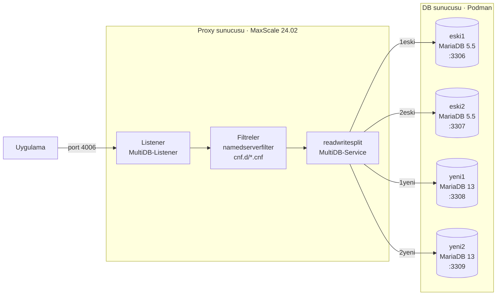

# MaxScale ile Kullanıcı Bazlı Veritabanı Yönlendirme

Tek bir porttan gelen MariaDB trafiğini, **bağlanan kullanıcının adına göre** farklı veritabanı sunucularına yönlendiren bir MariaDB MaxScale kurulumu.

Uygulamalar hep aynı adrese (`PROXY:4006`) bağlanır. Hangi veritabanına gidileceğine kullanıcı adı karar verir. Bu örnekte iki eski (MariaDB 5.5) ve iki yeni (MariaDB 13.x) sürüm Podman container'ı aynı proxy'nin arkasında birlikte çalışıyor.



| Kullanıcı | Hedef container | MariaDB | Host portu |
|---|---|---|---|
| `1eski` | eski1 | 5.5 | 3306 |
| `2eski` | eski2 | 5.5 | 3307 |
| `1yeni` | yeni1 | 13.x | 3308 |
| `2yeni` | yeni2 | 13.x | 3309 |

## Nasıl çalışır

1. Uygulama, proxy üzerindeki **4006** portuna örneğin `1yeni` kullanıcısıyla bağlanır.
2. MaxScale şifreyi, backend'lerden okuduğu kullanıcı listesiyle kendisi doğrular.
3. Her kullanıcı için tanımlı bir `namedserverfilter` vardır. Sadece `user=1yeni` olan filtre devreye girer ve sorguya "**yeni1**'e git" ipucunu (routing hint) ekler.
4. `readwritesplit` router bu ipucuna uyar ve sorguyu, okuma ya da yazma olmasına bakmadan yeni1'e gönderir.

Ayrıntılı anlatım için [docs/architecture.md](docs/architecture.md) dosyasına bakın.

## Repo yapısı

```
.
├── proxy/                      # MaxScale sunucusuna gidecek dosyalar
│   ├── maxscale.cnf            # → /etc/maxscale.cnf  (genel config)
│   └── maxscale.cnf.d/         # → /etc/maxscale.cnf.d/  (kullanıcı başına filtre)
│       ├── 1eski.cnf
│       ├── 2eski.cnf
│       ├── 1yeni.cnf
│       └── 2yeni.cnf
├── db/                         # Veritabanı sunucusuna gidecek dosyalar
│   ├── containers.sh           # 4 MariaDB container'ını oluşturur
│   └── db_users.sh             # Backend kullanıcılarını sıfırdan kurar
├── scripts/
│   └── test_routing.sh         # Uçtan uca okuma/yazma yönlendirme testi
├── docs/
│   ├── architecture.md         # Mimari ve nerede ne var
│   ├── configuration.md        # Config dosyalarının satır satır açıklaması
│   ├── installation.md         # Adım adım kurulum
│   ├── testing.md              # Test prosedürü
│   ├── adding-users.md         # Yeni kullanıcı ekleme
│   └── troubleshooting.md      # Karşılaşılan hatalar ve çözümleri
└── .env.example                # Şifre ve IP değişkenleri
```

## Hızlı başlangıç

```bash
git clone https://github.com/<kullanici>/maxscale-user-routing.git
cd maxscale-user-routing
cp .env.example .env    # IP ve şifreleri düzenleyin

# DB sunucusunda
./db/containers.sh
./db/db_users.sh

# Proxy sunucusunda
sudo cp proxy/maxscale.cnf /etc/maxscale.cnf
sudo mkdir -p /etc/maxscale.cnf.d && sudo cp proxy/maxscale.cnf.d/*.cnf /etc/maxscale.cnf.d/
sudo chown -R maxscale:maxscale /etc/maxscale.cnf.d
# /etc/maxscale.cnf içindeki DB_HOST ve şifreleri düzenleyin
sudo systemctl restart maxscale

# Test
./scripts/test_routing.sh
```

Kurulumun tamamı [docs/installation.md](docs/installation.md) dosyasında.

## Gereksinimler

- **Proxy:** MariaDB MaxScale 24.02 (24.02.9 ile test edildi), `mariadb` istemcisi
- **DB sunucusu:** Podman (Docker da olur), MariaDB 5.5 ve güncel MariaDB imajları
- Proxy, DB sunucusunun 3306–3309 portlarına erişebilmeli

## Önemli notlar

- Uygulama kullanıcıları **dört backend'in hepsinde** tanımlı olmalı, çünkü `readwritesplit` oturum başında tüm sunuculara bağlanır. Hangi sunucuya gidileceğini filtre belirler.
- Filtresi olmayan bir kullanıcının sorguları, monitörün "Master" olarak işaretlediği sunucuya gider.
- MariaDB 10.5 ve sonrasında monitör hesabı `SLAVE MONITOR` ve `BINLOG MONITOR` yetkilerine ihtiyaç duyar. Bu yetkiler yoksa sunucu `Auth Error` olarak görünür.
- Bu repodaki IP'ler ([RFC 5737](https://datatracker.ietf.org/doc/html/rfc5737) dokümantasyon aralığı) ve şifreler örnektir.

## Lisans

[MIT](LICENSE)
