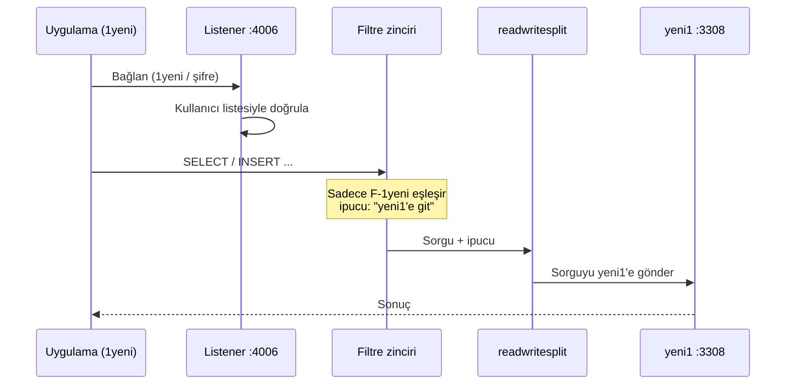

# Mimari

İstemciler tek bir porta (MaxScale, **4006**) bağlanır. MaxScale, bağlanan kullanıcının adına bakarak tüm sorguları o kullanıcıya atanmış MariaDB container'ına gönderir.

## Bileşenler

| Sunucu | Örnek IP | Rol | Yazılım |
|---|---|---|---|
| Proxy | 192.0.2.20 | Tek giriş noktası | MariaDB MaxScale 24.02 |
| DB sunucusu | 192.0.2.10 | 4 MariaDB container'ı | Podman |

| Container | MariaDB | Host portu | Yönlendirilen kullanıcı |
|---|---|---|---|
| eski1 | 5.5 | 3306 | 1eski |
| eski2 | 5.5 | 3307 | 2eski |
| yeni1 | 13.x | 3308 | 1yeni |
| yeni2 | 13.x | 3309 | 2yeni |

## Bir sorgunun yolculuğu

1. Uygulama `PROXY:4006` adresine bağlanır.
2. **Listener** (`MultiDB-Listener`) bağlantıyı `MultiDB-Service`'e devreder.
3. MaxScale kullanıcıyı **kendisi doğrular**. Bunun için `maxscale` hesabıyla backend'lerden önceden çektiği kullanıcı listesini kullanır.
4. `readwritesplit`, oturum için servisteki dört sunucuya da bağlantı açar.
5. Her sorgu filtre zincirinden geçer. Sadece kullanıcıya ait filtre devreye girer ve sorguya hedef sunucu ipucunu ekler.
6. `readwritesplit` ipucuna uyar ve sorguyu hedefe gönderir.

## Neden bu tasarım?

- **Neden `namedserverfilter`?** MaxScale'de "kullanıcı X'i sunucu Y'ye gönder" diyen tek satırlık bir ayar yok. Bu filtrenin `user=` parametresi, filtreyi tek bir kullanıcıyla sınırlıyor. `match01=/.*/` ise tüm sorguların eşleşmesini sağlıyor.
- **Neden `readwritesplit`?** Filtrelerin eklediği routing hint'lere uyan router'lardan biri. Okumaları ve yazmaları ipucundaki sunucuya gönderir.
- **Neden kullanıcılar her backend'de tanımlı?** `readwritesplit` oturum başında tüm sunuculara bağlanır. Kullanıcı bir backend'de yoksa o bağlantı başarısız olur.
- **Neden kullanıcı başına ayrı dosya?** MaxScale, `/etc/maxscale.cnf.d/` altındaki `.cnf` dosyalarını otomatik okur. Kullanıcı eklemek ve çıkarmak, genel config'e dokunmadan dosya eklemek ve silmek kadar basit olur. Tek istisna `filters=` satırı.

## "Master" neden eski1?

Sunucular arasında replikasyon yok. `mariadbmon` bir replikasyon topolojisi bekler, bulamayınca bağımsız sunuculardan birini master olarak işaretler. Bu kurulumda bunun bir anlamı yoktur, yönlendirmeyi filtreler yapar.

İki sonucu var:
- Filtresi olmayan bir kullanıcının sorguları eski1'e gider.
- `auto_failover` gibi otomatik failover ayarları **açılmamalıdır**, çünkü monitör birbirinden bağımsız bu sunucular arasında replikasyon kurmaya çalışabilir.

## Nerede ne var

### Proxy sunucusu

| Konum | İçerik |
|---|---|
| `/etc/maxscale.cnf` | Genel config: sunucular, monitör, servis, listener, filtre zinciri |
| `/etc/maxscale.cnf.d/<kullanici>.cnf` | Kullanıcı başına filtre (sahibi `maxscale:maxscale`) |
| `/var/log/maxscale/maxscale.log` | Hatalar ve uyarılar |
| `/var/lib/maxscale/` | Çalışma verisi. `maxctrl` ile yapılan kalıcı değişiklikler buraya yazılır ve `/etc` altındaki ayarları **ezer**. |
| `maxscale.service` | systemd servisi |
| port 4006 | Uygulama portu (tüm arayüzler) |
| port 8989 | `maxctrl` REST API (sadece 127.0.0.1, web arayüzü kapalı) |

### DB sunucusu

| Konum | İçerik |
|---|---|
| `db/db_users.sh` | Backend kullanıcılarını sıfırdan kuran script |
| Container'lar `eski1`, `eski2`, `yeni1`, `yeni2` | MariaDB, host portları 3306–3309 |
| Container içi `/var/lib/mysql` | Veri. Volume bağlı değilse container silinince veri de gider. |
| Container içi `mysql.*` tabloları | Kullanıcılar ve yetkiler, her container'da ayrı |
| `podman0` köprüsü (10.88.0.1) | Podman iç ağı, proxy bunu kullanmaz |

### Neyi değiştirmek için nereye gidilir

| Değişiklik | Yer |
|---|---|
| Kullanıcının gittiği container | `/etc/maxscale.cnf.d/<kullanici>.cnf` → `target01=` |
| Yeni kullanıcı | [adding-users.md](adding-users.md) |
| `maxscale` hesabının şifresi | `.env` (`MAXPASS`) **ve** `/etc/maxscale.cnf` içindeki iki `password=` satırı |
| Backend IP veya port | `/etc/maxscale.cnf` → sunucu bloklarındaki `address=` ve `port=` |
| Dinlenen port | `/etc/maxscale.cnf` → `[MultiDB-Listener]` → `port=` |
